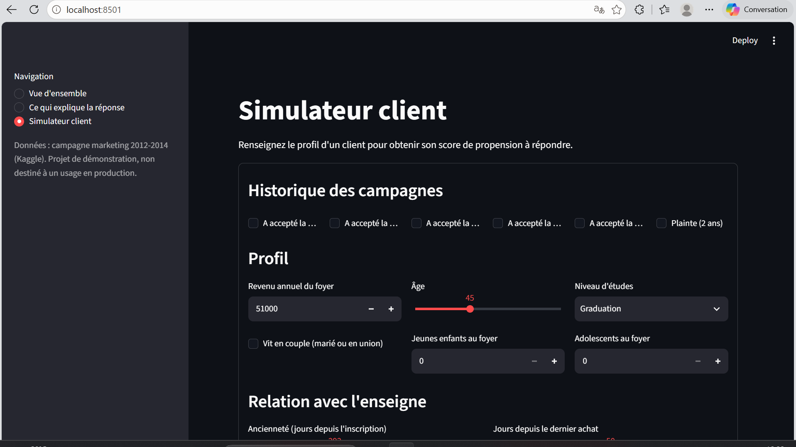
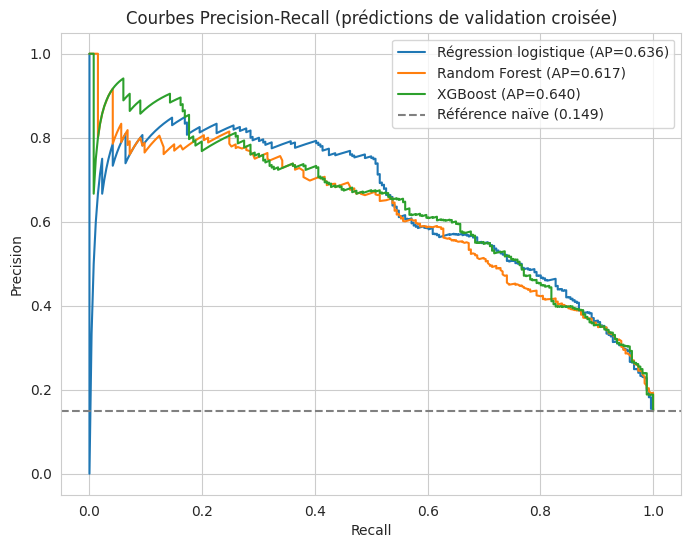
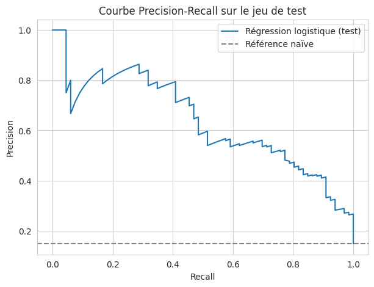

# Prédiction de la réponse à une campagne marketing

*Quels clients accepteront la prochaine offre ? Un modèle de prédiction, l'analyse de ce qui explique la réponse, et un dashboard interactif pour l'utiliser.*



---

## 1. Contexte du projet

Une entreprise vend des produits à ses clients (vin, viande, fruits, poisson, produits sucrés et produits « gold ») par trois canaux : **en magasin, sur son site web et par catalogue**. Pour stimuler ses ventes, elle mène régulièrement des campagnes marketing : elle envoie une offre à ses clients, et certains l'acceptent.

Le jeu de données ([Marketing Campaign, Kaggle](https://www.kaggle.com/datasets/rodsaldanha/arketing-campaign/data)) retrace l'historique de **2 240 clients** :
- leur **profil** : âge, niveau d'études, situation familiale, nombre d'enfants, revenu ;
- leur **comportement d'achat** sur les deux dernières années : montants dépensés par catégorie de produit, nombre d'achats par canal, visites du site, date du dernier achat ;
- leur **réponse à six campagnes successives** : les cinq premières (`AcceptedCmp1` à `AcceptedCmp5`) et la dernière (`Response`).

**Le problème.** Contacter un client a un coût, et la grande majorité ne répond pas : seuls **14,9 %** des clients ont accepté la dernière offre. Envoyer l'offre à toute la base est donc peu efficace. Si l'entreprise savait à l'avance quels clients sont les plus susceptibles d'accepter, elle pourrait concentrer ses efforts sur eux : plus de réponses pour le même budget, ou autant de réponses pour un budget moindre. C'est le rôle d'un **modèle de réponse**.

## 2. Objectifs

- **Comprendre** la structure des données et leur distribution.
- **Identifier les variables importantes** et les relations entre elles : qu'est-ce qui distingue un client qui répond d'un client qui ne répond pas ?
- **Prédire** si un client acceptera la dernière campagne (`Response`), et **évaluer honnêtement** la qualité de cette prédiction.
- **Communiquer** les résultats avec des visualisations claires et un dashboard utilisable par des non-techniciens.

## 3. Démarche

Le notebook [`notebook/marketing_campaign.ipynb`](notebook/marketing_campaign.ipynb) détaille chaque étape, avec une interprétation après chaque résultat. Voici le fil conducteur.

### 3.1 Comprendre et nettoyer les données

On commence par vérifier la qualité des données. Deux colonnes (`Z_CostContact`, `Z_Revenue`) sont constantes et ne peuvent donc rien apprendre à un modèle ; il n'y a aucun doublon ; 24 revenus sont manquants (1,1 %).

On repère aussi des **erreurs de saisie évidentes** : un revenu de 666 666 (le suivant le plus élevé est 162 397), trois clients nés en 1893, 1899 et 1900, et des situations maritales fantaisistes (`Absurd`, `YOLO`). Ces 8 lignes (moins de 0,4 % des données) sont **supprimées plutôt que corrigées** : on ne peut pas deviner la vraie valeur, et en inventer une reviendrait à fabriquer une donnée.

On regarde ensuite **la variable à prédire** : 85 % de non-réponses. Un modèle qui répondrait toujours « ce client ne répondra pas » aurait 85 % de bonnes réponses sans servir à rien. Cela impose de choisir des métriques adaptées (voir 3.3).

Enfin, on cherche **ce qui distingue les répondeurs** : taux de réponse par profil, comparaison des médianes, corrélations. Premier constat marquant : un client qui a déjà accepté une campagne passée répond **3 à 5 fois plus** que les autres. Le répondeur type est aussi plus ancien, a acheté récemment, dépense plus, vit seul et n'a pas d'adolescent au foyer.

### 3.2 Préparer les données

On crée des variables plus parlantes que les colonnes brutes : l'âge, l'ancienneté du client (en jours, jusqu'au 1er juillet 2014, juste après la fin de la collecte), le nombre total d'enfants, la dépense totale, le nombre de campagnes déjà acceptées et une variable « vit en couple ». Le niveau d'études est encodé dans l'ordre naturel des diplômes.

On sépare ensuite les données en un **jeu d'entraînement (80 %)** et un **jeu de test (20 %)**, avec la même proportion de répondeurs dans chacun. Le jeu de test est mis de côté et ne servira qu'une fois, à la toute fin. Tout ce qui apprend une statistique à partir des données (la médiane qui remplace les revenus manquants, la normalisation) est calculé **uniquement sur l'entraînement**, pour qu'aucune information du test ne s'infiltre dans le modèle.

### 3.3 Choisir comment mesurer la qualité

- **Precision** : parmi les clients que le modèle signale, quelle part répond vraiment ?
- **Recall** : parmi les clients qui répondent vraiment, quelle part le modèle repère-t-il ?
- **PR-AUC** : un seul chiffre qui résume la qualité du classement des clients, quel que soit le seuil choisi. C'est la métrique de référence. Elle se lit par rapport au hasard : un modèle sans aucune information obtient environ **0,15** (la proportion de répondeurs).

Pour comparer les modèles, on utilise une **validation croisée stratifiée à 5 plis** sur le jeu d'entraînement : avec seulement 334 répondeurs au total, un seul découpage donnerait des résultats trop dépendants du hasard.

### 3.4 Comparer les modèles

On part du plus simple (une régression logistique), puis on essaie des modèles plus puissants (Random Forest, XGBoost, SVM). On s'attendait à ce que les modèles non linéaires fassent mieux. **Ce n'est pas le cas** : tous arrivent sur le même plateau, avec des écarts plus petits que la variation d'un pli à l'autre.

Ce qui améliore vraiment les résultats, c'est la **préparation des variables** : les montants dépensés sont très asymétriques (beaucoup de petits montants, quelques très gros), et leur appliquer un logarithme fait passer la régression logistique de 0,653 à 0,681. Une fois cette transformation appliquée, la régression logistique rattrape la SVM la mieux réglée.

À performance équivalente, on retient la **régression logistique** : c'est le modèle le plus simple, le plus stable, et le seul dont on peut lire directement l'effet de chaque variable.

### 3.5 Comprendre ce qui explique la réponse

Les coefficients de la régression logistique ne suffisent pas : le revenu, les dépenses et les achats par canal sont très liés entre eux, ce qui rend les coefficients individuels peu fiables (certains changent même de signe par rapport à l'exploration). On mesure donc l'importance de **groupes de variables** : on brouille les valeurs d'un groupe entier et on regarde de combien la qualité du modèle chute.

### 3.6 Vérifier sur des données jamais vues

Le jeu de test est utilisé **une seule fois**, avec le modèle retenu, sans rien ajuster ensuite. Comme il ne contient que 66 répondeurs, on calcule aussi un intervalle de confiance pour mesurer l'incertitude du résultat.

### 3.7 Rendre le modèle utilisable

Le modèle est sauvegardé et intégré à une application **Streamlit** : un simulateur permet de saisir le profil d'un client et d'obtenir son score de propension à répondre.

## 4. Résultats

### Comparaison des modèles (validation croisée, jeu d'entraînement)

| Modèle | PR-AUC |
|---|---|
| Référence naïve (aucune information) | 0,149 |
| Random Forest | 0,630 |
| SVM (réglages par défaut) | 0,646 |
| XGBoost | 0,649 |
| Régression logistique | 0,653 |
| **Régression logistique + transformation log** | **0,681** |



### Performance finale (jeu de test : 447 clients, dont 66 répondeurs)

| Métrique | Valeur |
|---|---|
| PR-AUC | **0,64** (intervalle de confiance à 95 % : 0,52 à 0,76) |
| Référence naïve | 0,15 |
| Recall (seuil 0,5) | 80 % |
| Precision (seuil 0,5) | 47 % |

Parmi les clients signalés par le modèle, **47 % répondent réellement, contre 15 % en contactant des clients au hasard** : le ciblage multiplie le taux de réponse par environ 3.



### Ce qui explique la réponse

Baisse du PR-AUC quand on brouille un groupe de variables (plus la baisse est grande, plus le groupe compte) :

| Groupe de variables | Baisse du PR-AUC |
|---|---|
| **Campagnes passées** | **0,32** |
| Récence du dernier achat | 0,11 |
| Foyer (enfants, vie en couple) | 0,09 |
| Ancienneté du client | 0,09 |
| Canaux d'achat | 0,07 |
| Profil (revenu, âge, études) | 0,04 |
| Dépenses par produit | 0,03 |
| Plainte | 0,00 |

**Le meilleur prédicteur d'une réponse est d'avoir déjà répondu.** Viennent ensuite la récence, la composition du foyer et l'ancienneté (l'ordre entre ces trois groupes n'est pas fiable). L'importance des dépenses est sous-estimée par cette méthode, car elles sont très liées au revenu et aux canaux d'achat. Les plaintes n'apportent aucune information.

## 5. Le dashboard

L'application Streamlit (`app.py`) comporte trois pages :
- **Vue d'ensemble** : le problème, les résultats sur le test et la comparaison des modèles.
- **Ce qui explique la réponse** : l'importance des groupes de variables, avec une lecture commentée.
- **Simulateur client** : on renseigne le profil d'un client (historique de campagnes, profil, dépenses, achats) et l'application renvoie son **score de propension** et sa **position dans la base** (« mieux classé que X % des clients »).

Le score sert à classer les clients entre eux : le modèle est pondéré pour compenser le déséquilibre des classes, ce n'est donc pas une probabilité calibrée.

## 6. Limites et pistes d'amélioration

**Limites**
- **Petit échantillon** : 334 répondeurs au total, 66 dans le test. L'intervalle de confiance du score final est large, et des écarts de quelques points entre modèles ne sont pas démontrés.
- **Données anciennes (2012-2014)**, issues d'une seule entreprise : rien ne garantit que le modèle se généralise à d'autres contextes.
- **Pas de lien de causalité** : le modèle repère des profils qui répondent, il ne dit pas pourquoi.

**Pistes**
- Calibrer les probabilités pour obtenir de vraies probabilités de réponse.
- Tester des modèles de boosting réglés pour un petit échantillon, et des ensembles de modèles.
- Valider le modèle sur de nouvelles campagnes si des données plus récentes sont disponibles.
- Intégrer le coût d'un contact et le gain d'une offre acceptée pour décider du nombre de clients à cibler, si ces informations sont connues.

## 7. Structure du projet

```
marketing-campaign-prediction/
├── README.md
├── app.py                       # dashboard Streamlit
├── requirements.txt             # dépendances du dashboard
├── requirements-notebook.txt    # dépendances du notebook
├── notebook/
│   └── marketing_campaign.ipynb # analyse complète, annotée
├── models/                      # modèle sauvegardé (.joblib)
├── images/                      # graphiques utilisés dans ce README
└── data/                        # dataset non inclus (voir data/README.md)
```

## 8. Lancer le dashboard

Le modèle a été sauvegardé avec scikit-learn 1.6.1, qui n'est pas disponible pour les toutes dernières versions de Python : **Python 3.12 est recommandé**.

```bash
python -m venv venv
venv\Scripts\activate          # Windows  (Linux / macOS : source venv/bin/activate)
pip install -r requirements.txt
streamlit run app.py
```

L'application s'ouvre sur `http://localhost:8501`.

## 9. Reproduire l'analyse

1. Téléchargez `marketing_campaign.csv` depuis [Kaggle](https://www.kaggle.com/datasets/rodsaldanha/arketing-campaign/data) (voir `data/README.md`).
2. Installez les dépendances : `pip install -r requirements-notebook.txt`.
3. Ouvrez `notebook/marketing_campaign.ipynb`. Il a été conçu pour Google Colab : adaptez le chemin du fichier et ignorez les cellules propres à Colab, signalées dans le notebook.

## 10. Compétences mobilisées

- **Manipulation et nettoyage de données** : pandas, NumPy ; valeurs manquantes, doublons, erreurs de saisie, variables catégorielles.
- **Statistique univariée et multivariée** : distributions, taux de réponse par modalité, corrélations de Spearman.
- **Visualisation** : Matplotlib, Seaborn.
- **Modélisation et évaluation** : classification déséquilibrée, validation croisée stratifiée, choix de métriques adaptées, prévention de la fuite de données, intervalle de confiance par bootstrap.
- **Interprétation** : coefficients, importance par permutation.
- **Restitution** : dashboard interactif avec Streamlit.

**Outils** : Python, pandas, NumPy, scikit-learn, XGBoost, matplotlib, seaborn, Streamlit, joblib.
